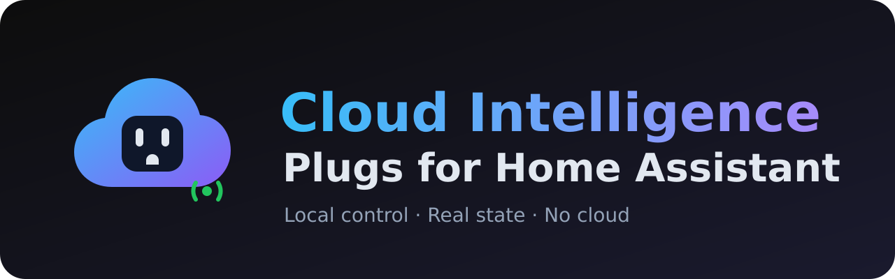

<p align="center">
  
</p>

<p align="center">
  <a href="https://github.com/hacs/integration"></a>
  
  <a href="https://github.com/jonathangibson98/ha-cloud-intelligence-plugs/releases"></a>
  
</p>

Control smart plugs that use the **Cloud Intelligence** app directly from Home Assistant. Home Assistant talks to each plug over your own Wi-Fi, so it doesn't depend on a cloud, Google, or Alexa, and it always knows whether the plug is really on or off.

> Cloud Intelligence is the stock app for Alibaba's IoT Living platform. A lot of cheap no-name Wi-Fi plugs and lights use it. Those plugs also include Alibaba's local control protocol (ALCS), and this integration uses it.

## ✨ Features

- 🔌 **One switch per plug**, showing its real on/off state (polled every 10 s by default, adjustable from 3 to 300 s)
- 🏠 **Fully local**: CoAP over UDP 5683 with the plug's own AES encryption, no internet needed
- 🔍 **Auto-discovery**: leave the IP blank and HA finds the plug. If its IP changes later, HA finds it again
- 🔑 **Re-auth flow**: if a plug's keys change, HA asks for the new ones instead of silently failing
- ⚡ **Fast**: on/off commands usually land in well under a second

**Tested with:** YX Smart Plug 8882 (product key `a1JG8An8ORa`). Other Cloud Intelligence plugs that expose a `powerstate` property should work too. Please open an issue to report what works.

## 📦 Installation

### HACS (recommended)

1. In HACS, open the **⋮** menu and choose **Custom repositories**.
2. Add `https://github.com/jonathangibson98/ha-cloud-intelligence-plugs` with type **Integration**.
3. Search for **Cloud Intelligence Plugs**, download it, then restart Home Assistant.

### Manual

Copy `custom_components/cloud_intelligence_plugs` into your HA `config/custom_components/` folder, then restart.

## ⚙️ Setup

**Settings → Devices & Services → Add Integration → Cloud Intelligence Plugs**. Add one entry per plug.

| Field | What to enter |
| --- | --- |
| **Name** | Whatever you want it called, e.g. *Galaxy Lights* |
| **Device name** | The plug's 12-character ID. It's the plug's MAC address without colons, e.g. `a1b2c3d4e5f6` |
| **Access key** | The plug's local access key (13 characters) |
| **Access token** | The plug's local access token (ends in `=`) |
| **IP address** | Optional. Leave it blank to auto-discover |
| **Product key** | Leave the default unless you have a different model |

## 🔑 Getting your plug's keys

The app downloads each plug's local keys from Alibaba's cloud when it opens. You grab them once by watching the app's traffic.

### Quick way: the key capture helper

On any Linux machine on your network that has Docker:

```bash
curl -fsSL https://raw.githubusercontent.com/jonathangibson98/ha-cloud-intelligence-plugs/main/tools/key_capture/run.sh -o run.sh
bash run.sh
```

It prints the phone setup steps, then waits. Open Cloud Intelligence on your phone and tap into each plug. Each plug's **Device name**, **Access key**, **Access token** and **Product key** appear in the terminal, ready to paste into Home Assistant. Nothing is saved to disk. Press **Ctrl+C** when you're done, then turn your phone's proxy off and delete the certificate profile.

### Manual way

If you'd rather use [mitmproxy](https://mitmproxy.org/) yourself:

1. **Run mitmproxy** on any computer on your network:
   ```bash
   docker run -d --name mitm -p 8080:8080 -p 8081:8081 mitmproxy/mitmproxy \
     mitmweb --web-host 0.0.0.0 --set web_password=changeme
   ```
2. **Point your phone at it:** go to **Wi-Fi settings → Configure Proxy → Manual** and enter the computer's IP and port `8080`.
3. **Install and trust the mitmproxy certificate:**
   - On iOS, open `http://mitm.it` in Safari and install the profile under **Settings → General → VPN & Device Management**.
   - Then turn on full trust under **Settings → General → About → Certificate Trust Settings**.
4. **Open Cloud Intelligence** and tap into each plug.
5. **Find the keys:** open `http://<computer-ip>:8081`, log in, and search for `accessInfo`. Each response looks like this:
   ```json
   {"deviceName": "a1b2c3d4e5f6", "accessKey": "AbCdEfGh10x1Y", "accessToken": "Zm9vYmFyYmF6cXV4ZXhhbXBsZT0=", ...}
   ```
6. **Turn the phone proxy back off** and remove the container with `docker rm -f mitm`.

> ⚠️ **Treat the keys like passwords.** Anyone on your network who has them can switch your plugs. Re-pairing a plug in the app may issue new keys. If that happens, HA shows a re-authentication prompt.

## 🧠 How it works

1. **Login:** HA sends the plug a random value signed with the access token (HMAC-SHA1). The plug answers with its own random value and a session ID.
2. **Session key:** both sides derive the key `HMAC-SHA1(token, clientRandom + deviceRandom)`.
3. **Commands:** every command (`thing.service.property.get` / `.set`) is AES-128-CBC encrypted with that key and sent as CoAP to `/sys/<productKey>/<deviceName>/thing/service/property/...`.
4. **Expiry:** sessions last 24 h on the plug. HA logs in again every hour, and immediately after any error.

## 🛠️ Troubleshooting

| Problem | Fix |
| --- | --- |
| *No plug with that device name answered* | HA can't reach the plug by multicast. Enter its IP address manually. VLANs or AP isolation block discovery. |
| *The plug didn't answer* | Check that the plug is online in the app and that UDP 5683 isn't blocked between HA and the plug. |
| *Rejected the access key or token* | The keys are wrong or the plug was re-paired. Capture fresh keys. |
| Switch goes unavailable sometimes | Set a DHCP reservation for the plug on your router. |

For debug logs, add this to `configuration.yaml`:

```yaml
logger:
  logs:
    custom_components.cloud_intelligence_plugs: debug
```

## ⚖️ Disclaimer

This is an unofficial community project. It isn't affiliated with Alibaba, Cloud Intelligence, or any plug maker. It only works with your own devices and your own keys.

## 🙏 Credits

The protocol work was based on Alibaba's open-source [Link Kit SDK](https://github.com/aliyun/iotkit-embedded) (ALCS client/server). The final-block encryption quirk was confirmed against [ha-cloud-intelligence](https://github.com/xiaoyaner0201/ha-cloud-intelligence).

## 📄 License

[MIT](LICENSE)
